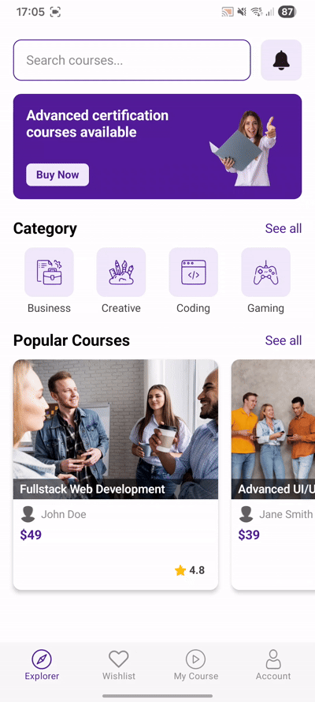
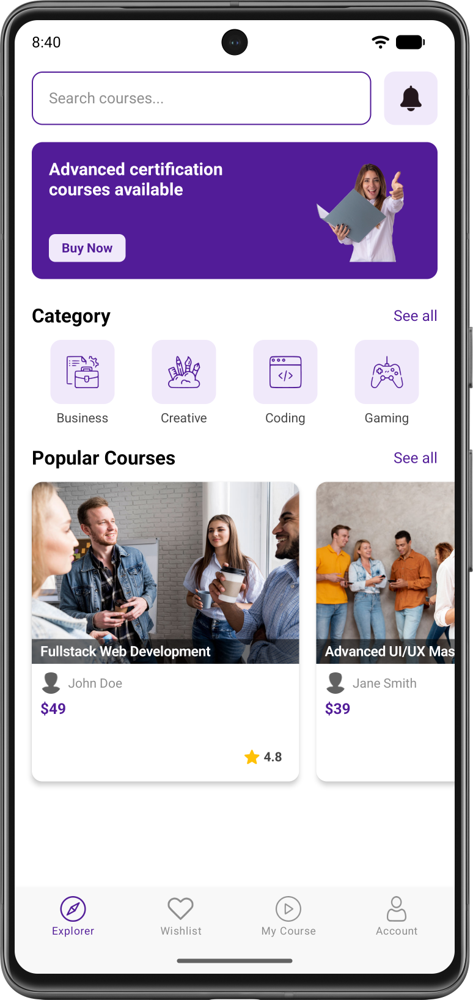
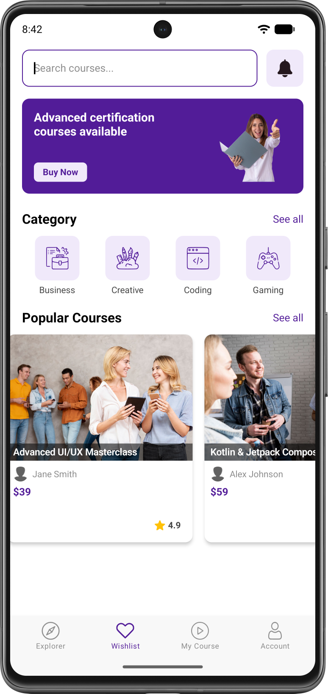
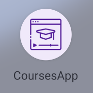

# 🎓 CoursesApp — Мобильное UI-приложение для онлайн-обучения

[](https://www.android.com/)
[](https://kotlinlang.org/)
[](https://developer.android.com/jetpack/compose)
[-orange.svg)](https://developer.android.com/about/versions/nougat)
[](https://developer.android.com/)
[](https://github.com/vlasov/CoursesApp/releases/tag/v1.0.0)

**CoursesApp** — современное мобильное приложение на Android для просмотра, поиска и выбора онлайн-курсов в различных категориях (программирование, дизайн, бизнес, геймдев). Приложение создано с использованием современного стекa Android-разработки — **Jetpack Compose** и декларативного подхода к построению UI.

---

## 📌 Описание проекта

**CoursesApp** предоставляет пользователям интуитивно понятный и удобный интерфейс для обучения:
- **Главный экран**: баннеры с акциями и возможностью быстрой покупки курса.
- **Категории курсов**: удобный выбор направлений (Business, Creative, Coding, Gaming).
- **Поиск курсов**: встроенная строка поиска с интерактивным вводом.
- **Популярные курсы**: горизонтальная прокрутка (`LazyRow`) карточек курсов с отображением рейтинга, преподавателя и стоимости.
- **Нижняя панель навигации**: быстрый переход между разделами (Explorer, Wishlist, My Course, Account).

---

## 🛠 Технологический стек

- **Язык программирования**: [Kotlin](https://kotlinlang.org/)
- **UI Framework**: [Jetpack Compose](https://developer.android.com/jetpack/compose) (Material 2 & Compose Foundation)
- **Компоновка карточек и баннеров**: [ConstraintLayout for Compose](https://developer.android.com/jetpack/compose/layouts/constraintlayout)
- **Управление отступами и системой**: `WindowCompat`, `WindowInsets`, `statusBarsPadding()`, `navigationBarsPadding()` (Edge-to-Edge)
- **Списки и контейнеры**: `LazyRow`, `Column`, `Row`, `Box`
- **Управление состоянием**: `remember`, `mutableStateOf`
- **Сборка проекта**: Gradle (Kotlin DSL), Android Gradle Plugin 8.+

---

## 🎬 Демонстрация работы (GIF)

Ниже представлена демонстрация работы интерфейса приложения и навигации:

<div align="center">
  
</div>

---

## 📱 Скриншоты

| Главный экран |  Поиск курса в панели поиска | Смена раздела в панели навигации |                                Иконка приложения                                |
| :---: |:---:| :---: |:-------------------------------------------------------------------------------:|
|  |  |  |  |

---

## ⚙️ Особенности реализации

1. **Declarative UI (Jetpack Compose)**: Вся верстка выполнена на чистом Compose без единого XML-файла разметки.
2. **Edge-to-Edge & System Bars Insets**:
   - Приложение полностью разворачивается на весь экран (`WindowCompat.setDecorFitsSystemWindows(window, false)`).
   - Нижняя системная панель навигации плавно интегрирована с `BottomAppBar` через `Modifier.navigationBarsPadding()`.
   - Прозрачный Status Bar с тёмными системными иконками для отличной читаемости на светлом фоне (`isAppearanceLightStatusBars = true`).
3. **ConstraintLayout Compose**: Сложные баннеры и карточки курсов со сложной привязкой элементов (заголовок, автор, цена, рейтинг) сверстаны с использованием `ConstraintLayout`.
4. **Кастомный BottomAppBar**: Панель навигации оформлена с вырезом `CircleShape` и подложкой `Surface`, предотвращающей наложение системной навигации на кликабельные элементы.

---

## 🚀 Запуск проекта

### 1. Клонирование репозитория

Для получения исходного кода выполните команду в терминале:

```bash
git clone https://github.com/kerikir/CoursesApp.git
cd CoursesApp
```

### 2. Открытие в Android Studio

1. Откройте **Android Studio** (Ladybug / 2024.+ или новее).
2. Выберите **Open** и укажите папку с клонированным проектом.
3. Дождитесь окончания синхронизации Gradle.

### 3. Сборка через Gradle CLI

- **Сборка Debug APK**:
  ```bash
  ./gradlew assembleDebug
  ```
  Исполняемый файл будет создан по пути:
  `app/build/outputs/apk/debug/CourseApp.apk`

- **Сборка Release APK (v1.0.0)**:
  ```bash
  ./gradlew assembleRelease
  ```
  Релизный артефакт будет создан по пути:
  `app/build/outputs/apk/release/app-release-unsigned.apk`

### 📦 Скачать готовый APK (Release v1.0.0)

Готовая сборка версии **v1.0.0** доступна в разделе релизов проекта:
- [Релиз v1.0.0 (APK)](https://github.com/kerikir/CoursesApp/releases/tag/v1.0.0)
- Локальный путь релизной сборки: `app/build/outputs/apk/release/app-release-unsigned.apk`
